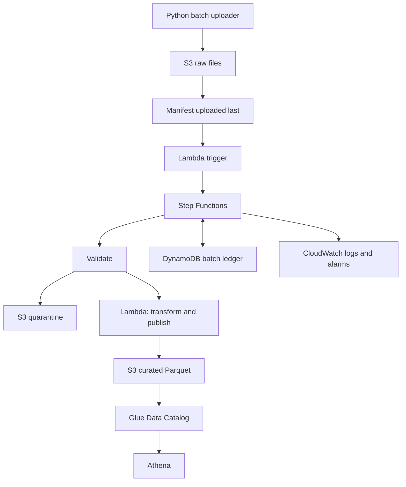

# Daily Order and Shipment Data Lake

A beginner data engineering project that will ingest daily supply chain batches into AWS, validate records, publish Parquet datasets, and support retries and historical reprocessing.

**Current status: Day 1 starter.** Local data inspection works. AWS resources and ETL stages are planned, not implemented. Running the starter makes no AWS calls.

## Open and run

Open this entire folder in your IDE. Install Python 3.11 or newer and Git if needed. In the IDE terminal, from the repository root:

```powershell
python -m venv .venv
.\.venv\Scripts\python.exe -m pip install -r requirements.txt
.\.venv\Scripts\python.exe scripts\inspect_data.py --data-dir data\sample
```

Select `.venv\Scripts\python.exe` as your IDE's Python interpreter. If `python` opens the Microsoft Store, install Python and restart your IDE; alternatively try `py -3` in place of `python` when creating the environment.

The inspector uses only Python's standard library, so you can also run it before installing dependencies:

```powershell
python scripts\inspect_data.py --data-dir data\sample
```

`requirements.txt` contains the libraries we will use in later ETL tasks. Terraform and AWS access are not needed for Day 1.

## Get the real dataset

Download **Brazilian E-Commerce Public Dataset by Olist** from its original publisher page:

https://www.kaggle.com/datasets/olistbr/brazilian-ecommerce

Kaggle may require a free account. Extract these files into `data/raw/`:

- `olist_orders_dataset.csv`
- `olist_order_items_dataset.csv`

Keep the original filenames. Other files can wait. Follow the source dataset's license and attribution terms; the source page lists CC BY-NC-SA 4.0. Do not commit the downloaded dataset. The included sample is synthetic and is not an Olist extract.

Inspect the real files and optionally save a local report:

```powershell
python scripts\inspect_data.py --report data\local\inspection.json
```

The report includes row counts, columns, empty-field counts, duplicate-key counts, timestamp ranges, invalid timestamp counts, and order items referencing absent orders. It does not print customer data or full records. This is exploratory inspection, not the production validation stage.

## Day 1 checklist

- [ ] Open the repository and select a Python interpreter.
- [ ] Run the inspector against the synthetic sample.
- [ ] Download and inspect the two Olist files.
- [ ] Identify the key and meaning of one row in each file.
- [ ] Explain why an order can have multiple order items.
- [ ] Explain why a delivery date can legitimately be empty.
- [ ] Read `docs/data-notes.md` and record your findings there.
- [ ] Make your first commit using your configured Git identity.

```powershell
git add .
git commit -m "Add Day 1 project scaffold and dataset inspector"
```

## Repository layout

```text
data/sample/       Tiny synthetic CSVs, safe to commit
data/raw/          Downloaded source files, ignored by Git
data/local/        Generated local reports, ignored by Git
scripts/          Local inspection and future batch upload tools
src/              Future validation and transformation code
infra/            Future Terraform definitions
sql/              Future Athena checks
tests/            Future pipeline behavior tests
docs/             Architecture, data notes, and build checklist
```

## Planned architecture



Terraform will define the AWS infrastructure. Glue is initially used for catalog metadata, not Spark processing. Historical batches simulate arrivals; they are not a live carrier feed. See `docs/roadmap.md` for the remaining days.

