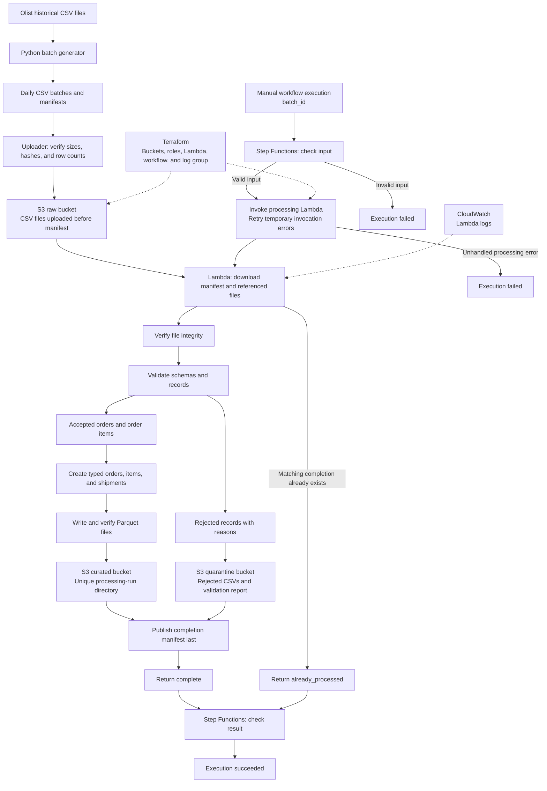

# Supply Chain Data Lake

An AWS data engineering project that replays historical order data as daily batches, verifies file integrity, and publishes raw files to S3 using manifests.

## Technology Stack

- Python, pandas, and Boto3
- Amazon S3
- Terraform
- AWS Region: Ohio (`us-east-2`)

## Current Features

- Inspect Olist order and order-item datasets.
- Generate daily CSV batches and JSON manifests.
- Verify file sizes, SHA-256 hashes, and row counts.
- Upload data files before publishing the manifest.
- Skip already published batch IDs.

## Architecture

```text
Historical CSVs
      ↓
Batch generator → Raw S3 files + manifest
                              ↓
                       Lambda invocation
                              ↓
                 Integrity checks and validation
                         ↙             ↘
                Quarantine          Accepted records
                                         ↓
                                Parquet transformation
                                         ↓
                                   Curated S3 files
                                         ↓
                                 Completion manifest
```

Terraform manages infrastructure. CloudWatch stores function logs.

## Project Structure

```text
data/
  raw/          Downloaded Olist files
  sample/       Synthetic examples
  local/        Generated batches and reports
scripts/        Inspection, generation, and upload tools
infra/          Terraform configuration
docs/           Data notes and architecture
src/            Future processing modules
sql/            Future Athena queries
tests/          Future automated tests
```

## Architecture



### Processing and Publication

- Step Functions coordinates one batch; validation, transformation, and publication run inside Lambda.
- Only files referenced by a completed manifest are considered published.
- Repeated processing of the same completed input returns `already_processed`.
- Failed attempts may leave unreferenced files without publishing a completion manifest.
- Workflow execution is currently manual. Automatic triggers, DynamoDB tracking, and Athena integration are planned.

## Setup

Requires Python 3.11+, AWS CLI v2, Terraform, and Git.

```powershell
python -m venv .venv
.\.venv\Scripts\python.exe -m pip install -r requirements.txt

aws login --profile supplychain-login
aws sts get-caller-identity --profile supplychain
```

Download the [Olist dataset](https://www.kaggle.com/datasets/olistbr/brazilian-ecommerce) and place these files in `data/raw/`:

- `olist_orders_dataset.csv`
- `olist_order_items_dataset.csv`

## Run

Inspect source data:

```powershell
.\.venv\Scripts\python.exe scripts/inspect_data.py
```

Generate seven historical batches:

```powershell
.\.venv\Scripts\python.exe scripts/generate_batches.py --start-date 2018-01-01 --days 7
```

Verify a batch locally:

```powershell
.\.venv\Scripts\python.exe scripts/upload_batch.py --batch-dir data/local/batches/olist-2018-01-01 --dry-run
```

Upload to the deployed raw bucket:

```powershell
$rawBucket = terraform -chdir=infra output -raw raw_bucket_name

.\.venv\Scripts\python.exe scripts/upload_batch.py --batch-dir data/local/batches/olist-2018-01-01 --bucket $rawBucket
```

## Data Flow

```text
Historical CSVs → Daily batches → Integrity checks → S3 files → Manifest
```

Each uploaded manifest references the exact S3 objects belonging to its batch. Failed attempts may leave unreferenced files; existing published batches are not overwritten.

## Validate a Batch

Run from the repository root:

```powershell
.\.venv\Scripts\python.exe -m scripts.validate_batch --batch-dir data/local/batches/olist-2018-01-01

## Planned Processing

Record validation, quarantine, Parquet transformation, Lambda, Step Functions, DynamoDB batch tracking, Glue Data Catalog, Athena, and CloudWatch monitoring.

## Notes

- Historical replay does not reproduce a live order or carrier feed.
- Follow the source dataset’s license and attribution requirements.
- Keep downloaded data, credentials, virtual environments, and Terraform state out of Git.
- AWS usage may incur charges.