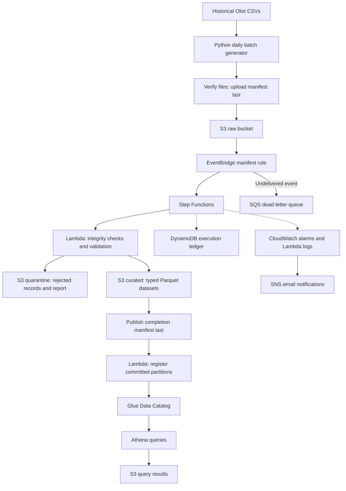
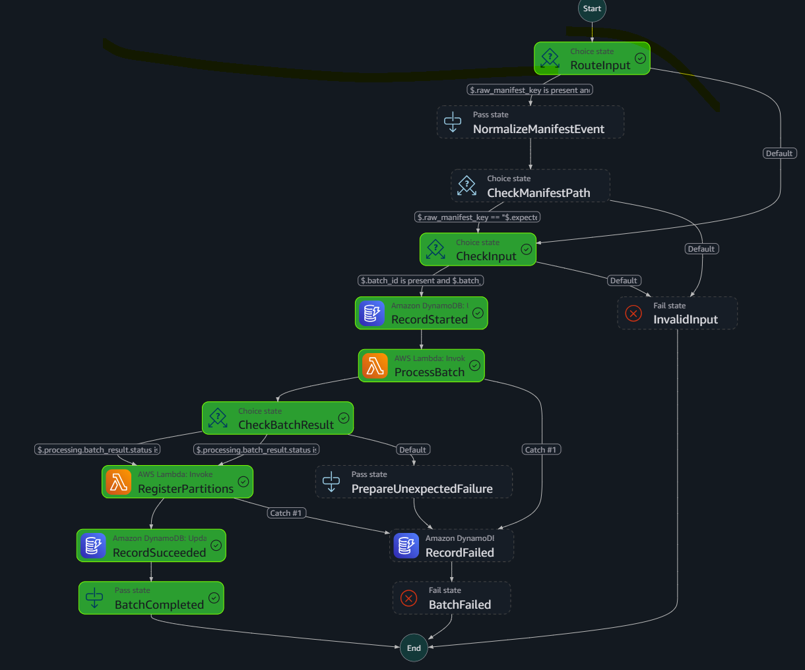

# Supply Chain Data Lake

An AWS data engineering project that replays historical Olist orders
as daily batches, validates records, publishes typed Parquet datasets,
and makes committed data queryable through Athena.

## Architecture



Terraform manages the infrastructure. The workflow also supports manual
execution using a batch ID.

## Workflow Execution



Successful manual execution showing batch processing, Glue partition
registration, and DynamoDB ledger updates. Green states indicate the
executed path; dashed states were not visited.

## Technology Stack

- Python, pandas, PyArrow, and Boto3
- Amazon S3 and AWS Lambda
- AWS Step Functions and Amazon EventBridge
- Amazon DynamoDB and Amazon SQS
- AWS Glue Data Catalog and Amazon Athena
- Amazon CloudWatch and Amazon SNS
- Terraform and GitHub Actions
- AWS region: Ohio (`us-east-2`)

## Datasets

| Dataset | Grain |
|---|---|
| Orders | One row per order |
| Order items | One item line within an order |
| Shipments | Derived order-level delivery record |

The source is a historical snapshot grouped by purchase date.
This is batch replay, not a reconstruction of what was known each day.

Shipment records are derived from order timestamps when carrier handoff
is present. They are not package-level tracking events. Source timestamps
retain their unspecified timezone.

Source: [Olist Brazilian E-Commerce dataset](https://www.kaggle.com/datasets/olistbr/brazilian-ecommerce).
Consult the source license and attribution requirements before reuse.

## Processing Guarantees

- Raw file sizes, SHA-256 hashes, and row counts are checked.
- Invalid records are quarantined with rejection reasons.
- Currency values use `decimal(18,2)`.
- Output artifacts are written before the completion manifest.
- Conditional manifest publication protects committed batches.
- Reprocessing matching committed input returns `already_processed`.
- Catalog registration accepts matching partitions and rejects conflicts.
- Workflow success is recorded after catalog registration.

Duplicate notifications may start additional executions. Failed or
competing attempts can leave unreferenced artifacts.

Registration across three Glue tables is not atomic. A replay can
complete missing registrations.

## Project Structure

```text
data/sample/       Synthetic fixtures committed to Git
data/raw/          Downloaded source data, ignored by Git
data/local/        Generated files and reports, ignored by Git
src/              Validation, transformation, publication, and catalog logic
scripts/          Batch generation, upload, and operator tools
infra/            Terraform and workflow definition
sql/              Athena verification queries
tests/            Offline automated tests
docs/             Data notes, verification, and recovery procedures
.github/workflows/ Automated project checks
```

## Local Setup

CI uses Python 3.12, matching the Lambda runtime family.

```powershell
python -m venv .venv
.\.venv\Scripts\python.exe -m pip install -r requirements-lock.txt

.\.venv\Scripts\python.exe -m pip check
.\.venv\Scripts\python.exe -m unittest discover -s tests -v
```

Place these source files in `data/raw/`:

- `olist_orders_dataset.csv`
- `olist_order_items_dataset.csv`

Downloaded source data is not required for the offline tests.

## AWS Deployment

Requires an AWS CLI profile named `supplychain` with access to the project.

```powershell
aws login --profile supplychain-login
aws sts get-caller-identity --profile supplychain

.\.venv\Scripts\python.exe scripts\build_lambda_package.py

terraform "-chdir=infra" init
terraform "-chdir=infra" validate
terraform "-chdir=infra" plan "-out=deploy.tfplan"
terraform "-chdir=infra" apply "deploy.tfplan"
```

Configure `alert_email` in a local Terraform variables file and confirm
the SNS subscription to receive notifications.

## Run a Batch

Use an unuploaded source date:

```powershell
.\.venv\Scripts\python.exe scripts\generate_batches.py --start-date 2018-01-12 --days 1

$rawBucket = terraform "-chdir=infra" output -raw raw_bucket_name

.\.venv\Scripts\python.exe scripts\upload_batch.py --batch-dir data\local\batches\olist-2018-01-12 --dry-run

.\.venv\Scripts\python.exe scripts\upload_batch.py --batch-dir data\local\batches\olist-2018-01-12 --bucket $rawBucket
```

Uploading the raw manifest starts processing automatically.
Inspect Step Functions for the outcome and query the registered date
partition through Athena.

## Reference Acceptance Counts

For purchase dates January 1–7, 2018:

| Dataset | Expected rows |
|---|---:|
| Orders | 1,383 |
| Order items | 1,561 |
| Derived shipments | 1,357 |

Verification SQL is stored in `sql/`.

## Monitoring and Recovery

Five alarms monitor workflow failures, timeouts, cancellations, trigger
queue backlog, and failures to deliver events to that queue.

Recovery starts a new execution for the same batch. Existing committed
data and matching partitions are reused.

The reconciliation tool previews corrections for interrupted executions
whose ledger records remain `running`. Applying a correction requires
`--apply` and uses conditional DynamoDB writes.

See [the recovery runbook](docs/recovery_runbook.md).

## Validation and Limits

GitHub Actions runs offline tests, builds the deployment package, and
validates Terraform on Windows and Linux.

CI does not verify a live AWS deployment. Record live demo and recovery
evidence separately.

The implementation targets small daily batches. It uses local Lambda
storage and pandas rather than distributed processing.

Keep Terraform state and private configuration outside Git.
AWS resources can continue to incur charges while idle.

See [cleanup instructions](docs/cleanup.md).